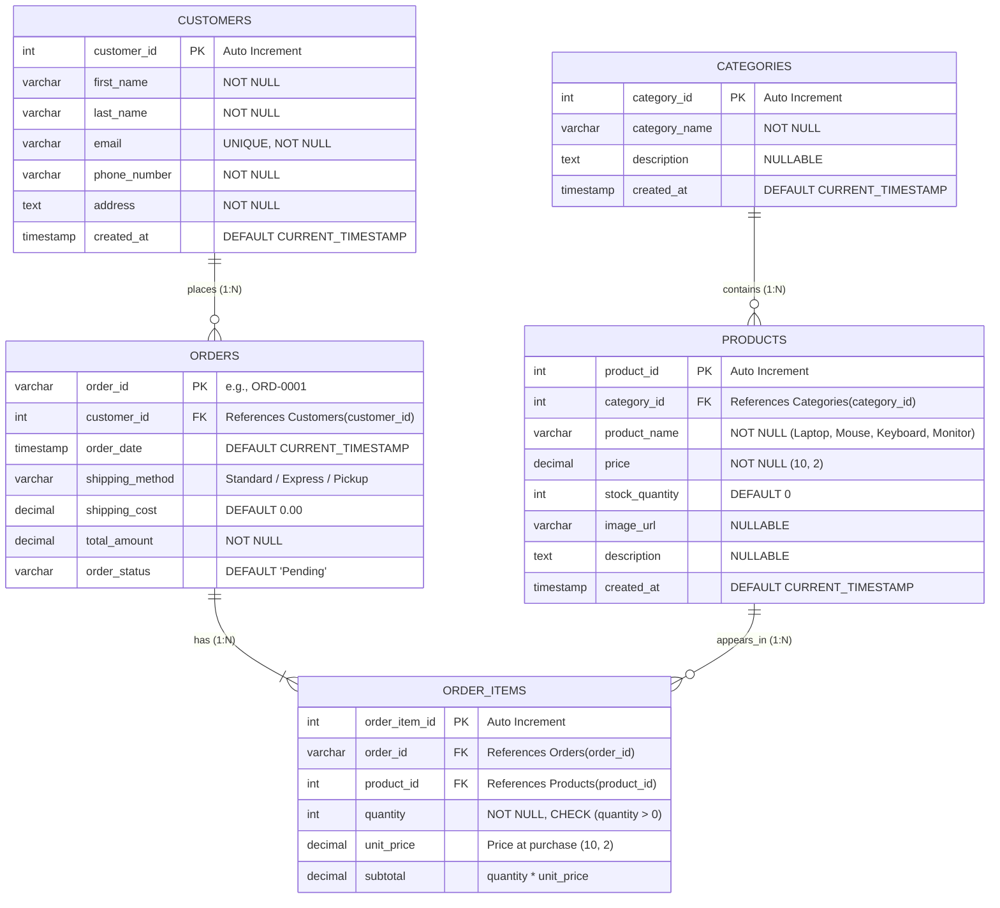

# E-Commerce Database Design & Practical Exercises Report
**Project:** React.js E-Commerce Order System  
**Tables:** Customers, Categories, Products, Orders, Order_Items  

---

## 1. Entity Relationship Diagram (Crow's Foot Notation)



---

## 2. Table Relationships Summary

1. **Categories $\rightarrow$ Products (1 : N)**
   - One category can have multiple products.
   - `Products.category_id` references `Categories.category_id`.
2. **Customers $\rightarrow$ Orders (1 : N)**
   - One customer can place many orders over time.
   - `Orders.customer_id` references `Customers.customer_id`.
3. **Orders $\rightarrow$ Order_Items (1 : N)**
   - One order contains one or more line items.
   - `Order_Items.order_id` references `Orders.order_id`.
4. **Products $\rightarrow$ Order_Items (1 : N)**
   - One product can appear in multiple order line items.
   - `Order_Items.product_id` references `Products.product_id`.

---

## 3. Product Catalog (Practical Exercise 1)

| Product Name | Category | Unit Price | Initial Stock |
|---|---|---|---|
| Laptop | Computers | $650.00 | 12 |
| Mouse | Accessories | $15.00 | 45 |
| Keyboard | Accessories | $25.00 | 30 |
| Monitor | Displays | $120.00 | 18 |

---

## 4. How to Run the React.js Application

1. Open terminal inside this folder:
   ```bash
   npm install
   npm run dev
   ```
2. Open your browser and navigate to:
   ```
   http://localhost:5173/
   ```
